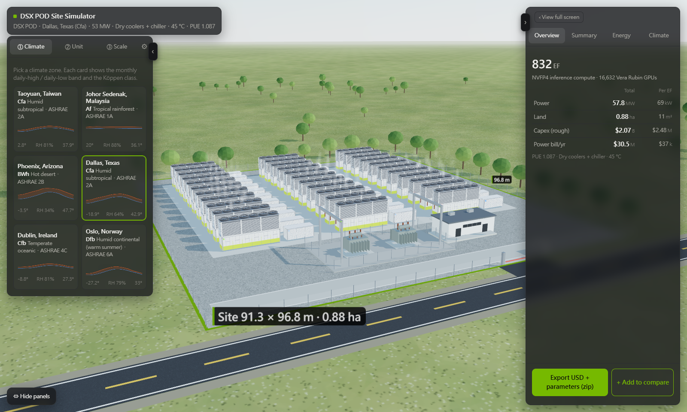
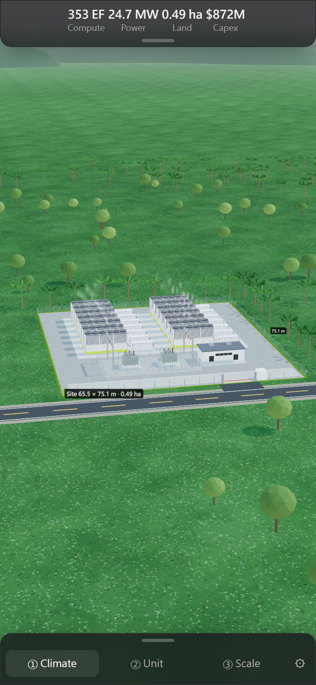

# Modular AI Data Center Site Simulator

**Explore how much AI compute fits on a piece of land, how much power it draws, what it costs, and whether the local climate can cool it — then take the result into NVIDIA Omniverse as OpenUSD.**

**Live demo: https://dsxpod.vercel.app/** (desktop and mobile)

## What it does

1. **Climate** – pick one of six sites (Taoyuan, Johor, Phoenix, Dallas, Dublin, Oslo), each backed by 20 years of hourly ERA5 weather.
2. **Unit** – choose the containerised product: **NVIDIA DSX POD** (7 × Vera Rubin NVL72, warm-water dry cooling) or **GIGABYTE GADU** (5 rack SKUs, chilled-water cooling).
3. **Scale** – give the land size (or a power target, up to 1 GW). The tool lays out units, blocks, roads and substations.

An always-on dashboard reports **compute (EF), facility power, land and capex — both in total and per exaFLOP**, so different products and sites can be compared on the same footing. Up to three scenarios can be saved, compared side by side, and shared as a link.

## Why it is interesting

- **Climate feasibility, not just a PUE number.** NVIDIA states that 45 °C warm-water cooling removes the need for chillers. Running the thermal model hour by hour over 20 years shows where that holds and where it does not: dry coolers alone reject all heat in Dublin at every scale and in Oslo up to ~35 MW, but Phoenix would miss heat on more than a thousand hours a year. The tool therefore picks the cooling automatically with a strict rule (*zero unmet hours in 20 years*) and explains why.
- **Vendor-neutral, fair comparison.** All products use the same rack power for the same GPU (Vera Rubin NVL72 at 230 kW, Max-P), the same capex basis (ODM / hyperscale procurement prices) and the same quantity rules for facility equipment.
- **A digital-twin seed, not a picture.** The OpenUSD export carries equipment specs (`aif:*` attributes), switchable variants (site, cooling, geometry detail), USD Collections for one-click selection, cost coefficients and the energy results — ready to continue in Omniverse for CFD and detailed design.

## OpenUSD export

`POST /api/export` builds a zip with:

- `data/twin/pod.usda` (or `campus.usda` for multi-block sites) with VariantSets `site`, `cooling`, `supply_temp`, `geometry` (box / Vertiv real models / full)
- results and checks as sublayers (`pod_results.usda`, `pod_checks.usda`), including capex and operating cost
- `results.json`, `results_annual.csv`, `params.json` (every model parameter with the USD attribute it was read from)
- a script to fetch the Vertiv SimReady models (CC-BY-4.0) for full geometry

USD is the source of truth: model parameters are read back from the stage, and the acceptance tests require zero fallback values.

## How it works

| Layer | Technology |
|---|---|
| 3D view | three.js (instanced meshes, on-demand rendering, LOD, adaptive resolution while moving), CSS overlay for heat plumes and lights |
| Results | 20-year hourly simulation per site, product, cooling and scale (Python), precomputed into a grid and interpolated in the browser |
| Energy model | hour-by-hour heat balance: dry coolers (approach + fan affinity), trim chillers (COP vs. ambient), chilled-water plant (Carnot-efficiency COP), pumps from rack flow and pressure-drop curves, envelope gains, recirculation and campus heat island, glycol freeze protection per site |
| Capex | racks plus equipment and materials of all above-ground works; excludes land and construction labour (rough, ±30–50%) |
| Export | FastAPI on Vercel serverless, `usd-core` |

## Data sources

- Weather: ERA5 reanalysis via Open-Meteo, 2005–2024, hourly
- Products: NVIDIA DSX POD announcement (GTC Berlin 2026), GIGABYTE GADU specification table, public rack power figures (Vera Rubin NVL72 Max-Q / Max-P)
- Equipment specs: Vertiv SimReady assets (CC-BY-4.0); rack spec values written by this project (no NVIDIA asset files are redistributed)
- Prices: analyst estimates for racks (e.g. Morgan Stanley BOM analysis), public bid tabulations for construction materials, regional industrial electricity prices (EIA, Eurostat, Taipower, TNB)

Every coefficient is stored in the exported USD with its source and a confidence level.

## Limitations

This is a **screening tool for early-stage siting and sizing**, not a design-grade estimate. Capex is rough (±30–50%); heat island and recirculation use screening-level models and key sites need CFD; electricity prices are regional averages, not contract prices.

---

Built by Joseph Chen. The frontend and the serverless function in this repository are generated from a private working repository (`scripts/build_vercel.py`); please open an issue rather than a pull request.
